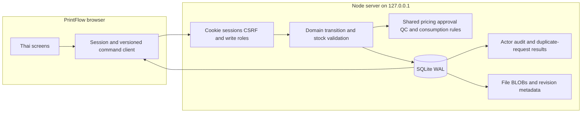

# PrintFlow architecture / v0.2

[PRD](PRD.md) defines requirements, [design system](DESIGN_SYSTEM.md) defines UI, [sources](SOURCES.md) records authoring tools and [agent index](AGENTS.md) provides entry points.

## Independent boundaries
PrintFlow is the print shop's own ERP for cartons and sheet stickers. It has no Odoo foundation and no dependency on another business system. GitHub Pages is a public browser-local demo; the central local app is served by its own Node.js backend.

## Observed central architecture

The same frontend runs in two modes. Static runtime-config.js selects browser mode; the Node server returns /api configuration. Central login must complete before loading business state. Failures do not switch to browser persistence. API reads and downloads require a session. Writes require session, matching Origin and CSRF token plus role checks.

## Components and authority
| Entity | Central authority | Demo alternative |
|---|---|---|
| Quotes, jobs, materials, tools, master registries | SQLite versioned erp_state JSON | localStorage |
| Users/password hashes | users table, salted scrypt | None |
| Sessions | Hashed session token, HttpOnly SameSite cookie, 8-hour expiry | None |
| Revision files | SQLite BLOB + SHA-256 metadata | IndexedDB |
| Audit | Server actor/time/version rows and state projection | Mutable browser event list |
| Idempotency | Request id, actor and stored outcome | None |

## Transactions and invariants
BEGIN IMMEDIATE reads the current dataset revision, rejects stale versions, validates proposed changes, computes stock effects and commits state/audit/result together. Failed validation rolls back. Client-supplied audit is replaced by server authority. Role checks apply to changed domains/fields. Direct stock edits are rejected unless explained by PO receipt, validated printing-start consumption, or actual-use issue/return.

Accepted quotes create one job/order using computed price and matching specification. Production start requires proof metadata for the exact revision, stored evidence and readiness flags. Referenced tools must be ready. Later stages advance one step. Full-quantity QC with four checks and no rejects is required for delivery. Cost entries determine actual totals; primary sheet quantity determines stock adjustment. No auxiliary-material ledger or partial shipment is implemented.

## Data and files
The pilot uses a whole-dataset revision. This intentionally rejects competing stale edits; it is not a normalized multi-entity ERP database. Files up to 10 MB are stored in SQLite and downloaded as attachments. Browser JSON backups exclude IndexedDB bytes; central database backup must include file BLOBs. Upload and linking are separate calls, so failed linking can leave an unreferenced BLOB. Restore and cleanup/retention policies remain to be verified.

## Roles and privacy
Admin manages accounts; sales writes customers/quotes/orders; planner writes tools/files/approval/routing/support records; warehouse receives/reserves; operator advances production; QC records inspection; accountant records costs/actual material; viewer reads. All authenticated roles currently read the full business dataset. Fine financial visibility, recovery/MFA and account deactivation UI are not implemented. Existing active status is checked by API sessions.

The real local server has no fixture login account. The first administrator chooses credentials in setup. QA uses a separate fixture database and account. No databases or auth secrets belong in source archives. The server binds loopback; office/public access needs a separate hosting/TLS decision.

## Evidence ledger
| Claim | Classification | Evidence |
|---|---|---|
| Local Node/SQLite backend and file storage | Observed | server/server.cjs |
| Calculator, approval, QC and material rules | Observed/tested | core and production tests |
| Auth/role/conflict/idempotency and rollback gates | Observed/tested | server.test.cjs |
| UI quote-to-delivery with file proof and actual-use stock | Observed | Separate QA browser walkthrough |
| Actual shop rates, inventory and QC correctness | Unknown | Fixtures only |
| Load capacity, normalized migration and restore guarantees | Unknown/future | No sustained operational drill |
| Odoo or external warehouse dependency | Absent | No runtime integration |

## Next release boundaries
Complete business pilot and backup restore before go-live. Add normalized relational entities, arbitrary UOM/lot/location accounting, granular read permissions and office hosting as separate phases. Roll labels and CAD/machine capacity require their own models. SQLite is a local server database here, not a shared file opened by browser clients. All future clients use its API.

The architecture-analysis skill is applied to observed/inferred/unknown classifications and actual code boundaries, not as a claim of a full production security audit.
