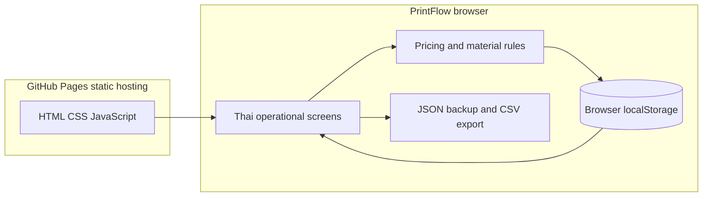
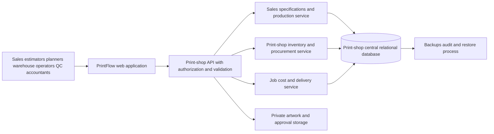

# Architecture: PrintFlow — Independent Print-Shop ERP

14 October 2026. [PRD.md](PRD.md) defines requirements; [DESIGN_SYSTEM.md](DESIGN_SYSTEM.md) defines interface patterns; [SOURCES.md](SOURCES.md) records research and authoring tools; [AGENTS.md](AGENTS.md) lists development entry points.

## Product vision and boundaries
PrintFlow is an independent ERP for the print shop's cartons, packaging and sheet stickers. It manages its own customers, specifications, quotes, orders, materials, production jobs, quality and job costs. Other business systems do not define this product's architecture. Reusing an authoring skill creates no runtime or business-data dependency.

## Implemented prototype / observed

GitHub Pages serves static files; all current business calculations and records remain in the browser. No central application API or database is implemented. The published page is public; records entered by visitors are local to their browser profile. Google Fonts loads typography only. Static HTTP hosting is portable; the earlier Sites host is a separate static deployment option.

## Current entities and authority
| Entity | Current storage and behavior | Limitation |
|---|---|---|
| Customer and job specification | Browser quote/job fields | No central customer master |
| Quote | Deterministic calculator and saved input rates | Illustrative rates, no accounting rounding policy |
| Job | Accepted quote copied once to job | Manual confirmations; no signed approval files |
| Materials | Stock per SKU and job reservation | Sheet units, no lot/location ledger |
| Purchase | Full receipt increases stock once | No partial receipt or vendor invoice matching |
| Production | Ordered stage transitions | No machine capacity optimization |
| Actual job cost | Manual total compared with estimated cost | No itemized time/material costing |
| Audit | Local event list | User-editable, not a production audit authority |

## Product-specific calculation
Cartons: finished size, flat size, board grade, confirmed Ups, waste, setup sheets, colours, die/tool and finishing. Sheet stickers: label size, size including allowance, adhesive-paper or PP sheet material, confirmed labels per sheet, Cutline, lamination, Kiss-cut/Through-cut and sheet splitting.

Net sheets = ceil(quantity / Ups). Required sheets = ceil(net sheets × (1 + waste percentage)) + setup sheets. Cost includes sheet material, printing, finishing per item, tooling, subcontracting and overhead. Sale price = total cost / (1 − target gross margin).

These calculations assume sheet-based production. Roll stickers require their own web width, length, repeat, lanes, roll count, core and unwind-direction model; they are not implemented. CAD layout validation, ink coverage and adhesive suitability require operational confirmation.

## Workflow / observed

## Mutation and failure behavior
The client copies state, applies a change, validates it and saves to localStorage. Failed writes restore the prior state. Reserving changes available quantity without reducing stock. Starting production requires all readiness checks and complete reservation, then debits stock once. Further stage transitions do not repeat the debit. Purchase receipts reject repeats. Backups are checked before replacement and replacement requires confirmation.

Corrupt prior storage is retained; writes stop while a sample view is displayed. Newly added sticker SKUs start at zero when upgrading an existing browser dataset, preserving old material balances. Cross-tab notifications show updates but do not guarantee atomic concurrent edits. This is an explicit prototype limitation.

## Proposed independent production architecture / not implemented

Each component belongs to this print shop ERP. Start with a modular application and one relational database to keep inventory reservations, issues, receipts and job transitions transactional. PostgreSQL through authenticated HTTP endpoints is one proposed foundation; an independently assessed Odoo deployment is another product choice. Neither is installed or selected as the current backend.

## Future database and API requirements
Core entities: customer, product/SKU, job specification revision, estimate version, sales order, BOM/routing, work center, tool, material lot/location, reservation, stock movement, purchase receipt, work log, QC check, delivery and cost entry. Each inventory movement identifies SKU, quantity, UOM, source/destination, job reference, actor and timestamp.

Require server-side employee permissions, decimal monetary amounts, unique request identifiers, optimistic record versions and atomic stock transactions. Repeated requests must return the same committed result. Failed transactions must not leave partial inventory/job updates. Return material and record actual consumption rather than assuming the estimate was consumed in production.

Files need private storage, immutable version references and evidence of customer approval. A production job references the approved version; changing the file creates a new revision. S3-compatible object storage is one portable option. JDF/XJDF machine exchange is a future capability only where the actual machines and software support it.

## Privacy and roles
Proposed roles: sales, estimator, planner, warehouse, operator, QC, accountant and admin. Enforce cost visibility and write rights on the server. Hosting a public static page does not provide employee authentication. Production backup and restore targets, access retention and approval retention must be agreed with the print shop owner.

## Evidence ledger
| Claim | Classification | Evidence |
|---|---|---|
| Static website and browser-local records | Observed | index.html, app.js and core.js |
| Calculator and inventory gates | Observed/tested | Nine core tests, browser quote/job walkthrough |
| Sticker presets and Cutline carried to job | Observed | Browser walkthrough |
| Central API/database diagram | Proposed | Independent requirements, no implementation claimed |
| Live stock accuracy and actual shop rates | Unknown | No actual business records supplied |
| Employee authorization and recovery guarantees | Unknown/not implemented | No central backend |

## Release criteria
Prototype: calculator, inventory gates and carton/sticker forms pass. Shared MVP: employee auth, central records, inventory ledger and transaction/retry tests pass. Pilot: reconcile opening stock, validate rates against real jobs, capture actual consumption and restore backups. Go-live: owner accepts job documents, QC, stock and cost reports. Later phases add roll stickers, machine scheduling and accounting integration.

This document describes an independent ERP. Source analysis distinguishes observed prototype facts from proposed production architecture and unknown operations. Authoring skills are development aids; a complete production security audit remains separate work.
