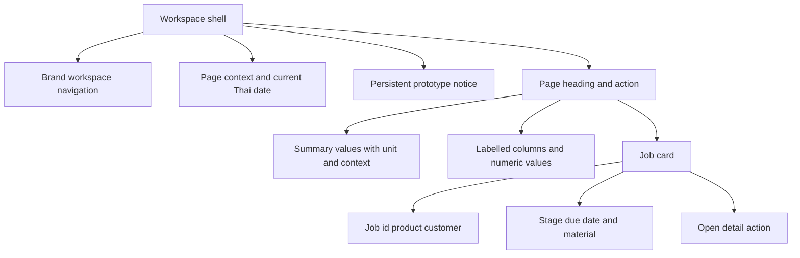

# PrintFlow design system / v2.0

## 1. Overview
Thai operational workspace for reviewing carton and sheet sticker jobs and paper availability. The main screen prioritizes due dates, missing approvals and low materials. [PRD.md](PRD.md) defines scope and [ARCHITECTURE.md](ARCHITECTURE.md) defines data boundaries. This document records the current pilot rather than unimplemented components.

## 2. When to use / when not to use
Use cards for a job stage and summary indicators; use tables for stock and comparable cost amounts. Use the board for process status. For machine start/end times use a future capacity schedule rather than presenting this board as a scheduling optimizer. Informative badges do not replace buttons or permissions.

## 3. Anatomy

Job identity, product, quantity, due date and stage are required. Detailed specifications live in the dialog. Input limits: customer/product 120 characters; dimensions/die/colours 80; finishing/revision 120. Numeric fields have business minimums and margin is less than 100%.

## 4. Variants
Primary button: teal for a commit or next action. Ghost button: white bordered for secondary actions. Badge variants: green ready, amber waiting/attention, blue in progress, red overdue. State always includes text, not colour alone. Empty table states explain how to start. No animated KPI counters or fabricated progress values.

## 5. States
| Component | States |
|---|---|
| Input | Default, focus, HTML validation invalid |
| Calculator | Valid computed summary, invalid explanatory message |
| Jobs | Preparation, printing, finishing, die/glue, QC/ship, delivered |
| Readiness | Missing proof, approved current revision, outdated revision |
| Material | Available or below reorder threshold |
| Cost | Missing actual, seven itemized quantity/rate categories, over/under estimate |
| Import | Selected, invalid rejected, preview and replacement confirmation |
| Persistence | Ready, write failure with rollback, corrupt prior data read-only |
| Dialog | Open with focus trap / Escape close / closed |
| Notice | Prototype banner and corrective-action toast |

Connected mode shows setup/login before business data, pending writes, server errors, and stale-version conflicts with reload. Failed writes roll back. File controls show local or server storage. QC records show check results and inspected/good/rejected counts; failed QC blocks delivery. Demo mode remains local. A failed API must not show confirmed zero stock.

## 6. Design tokens used
| Token | Value | Role |
|---|---|---|
| --ink | #173137 | Main headings and body |
| --muted | #586d72 | Secondary content, final override |
| --line | #e1e8e7 | Borders and separators |
| --teal | #087e73 | Primary actions and current nav |
| --mint | #e2f4ee | Active/ready background |
| --bg | #f5f7f6 | Workspace background |
| --orange | #bd7431 | Attention icons |

Current geometry uses CSS literals: sidebar 240px / 205px, main gutter 34px / 25px / 16px, card radius 10px, button radius 7px, grid gap 20px. These are observed values, not claims that a full token library exists. Typography: IBM Plex Sans Thai via Google Fonts with system fallback; body 14px, page heading 29px, table 12px. Main breakpoints 1150px and 760px. CSS final rules supply focus, muted colour and touch sizing.

## 7. Usage examples
Correct: “พร้อมใช้ 1,600 แผ่น” is distinct from stock and reservation. Correct: “ยังไม่บันทึก” for missing actual cost. Correct: a button says “เริ่มพิมพ์ / เบิกกระดาษ” when it also changes inventory.

Incorrect: presenting a missing API response as “คงเหลือ 0”; display an error. Incorrect: “กำไร 25%” without identifying margin versus markup; label it as percentage of sales. Incorrect: colour-only overdue indicator; also show the due date and overdue text.

## 8. Accessibility
Thai document lang, explicit label/input association, nav aria-current and toast role=status. Native dialogs supply modal focus containment and Escape close. Cards support Enter/Space and visible focus. Buttons have 44px base height; compact desktop actions are 36px and become 44px on mobile. Tables scroll horizontally on narrow screens. Contrast for main text, muted text and primary actions is checked numerically; this is not a full WCAG certification. No motion is introduced, so reduced-motion has no animated behavior to disable. Symbol close controls require an explicit accessible name.

## 9. Related components
Job detail shares states with board cards; calculator summary shares monetary formatting with cost tables; inventory table shares available-stock calculations with reservation actions. [AGENTS.md](AGENTS.md) lists entry points; [SOURCES.md](SOURCES.md) records the design-system-doc skill provenance.

## 10. Changelog
v2.0 / 2026-10-14 / Codex: Thai packaging workspace, prototype banner, calculator, job stages, material table, cost comparison and keyboard/touch rules.
